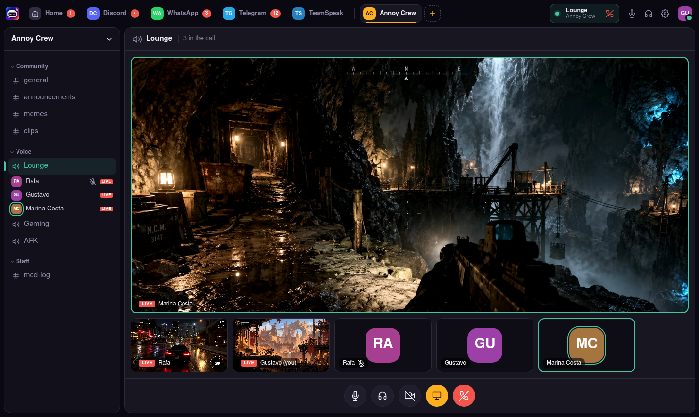
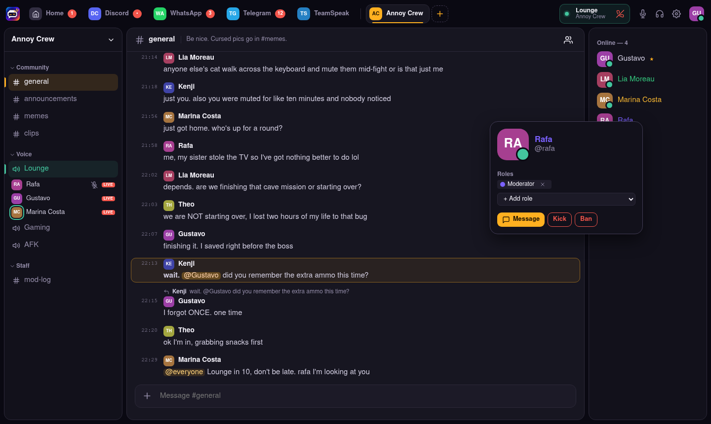
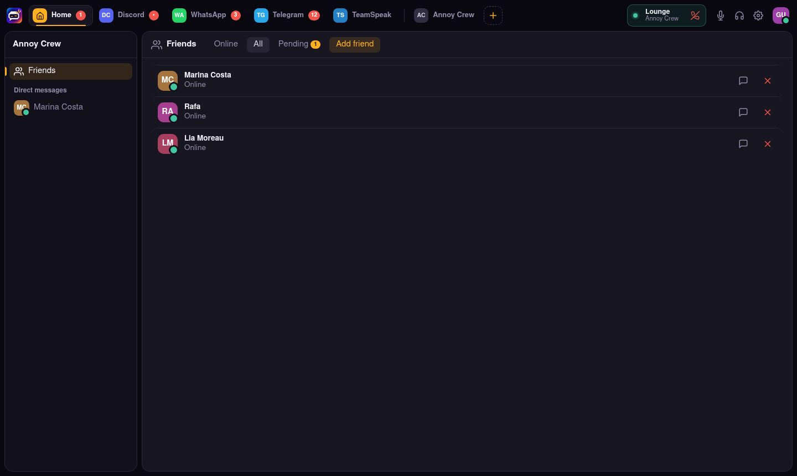
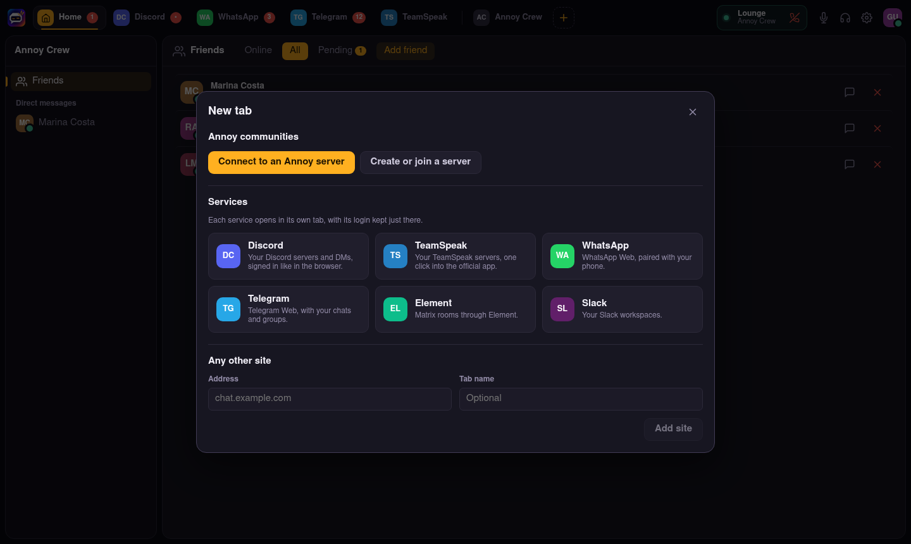
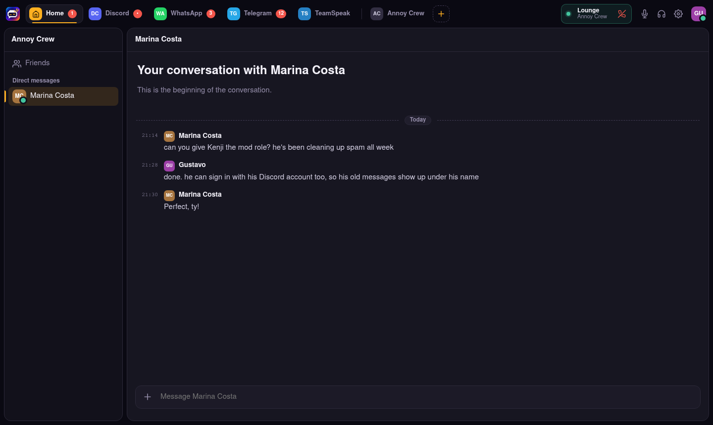

<div align="center">

# Annoy Client

**One desktop app for all your communities: self-hosted Annoy servers plus Discord, WhatsApp, TeamSpeak and more, each in its own tab.**

[](LICENSE)


**English** · [Português (Brasil)](README.pt-BR.md)

[Download](#download) · [Features](#features) · [Screenshots](#screenshots) · [Build from source](#build-from-source) · [How service tabs work](#how-service-tabs-work) · [Server](https://github.com/GeGLab/annoy-server)


</div>

## Download

| Platform | File |
| --- | --- |
| **Windows 10/11** (x64) | [Annoy-Setup-x64.exe](https://github.com/GeGLab/annoy-client/releases/latest/download/Annoy-Setup-x64.exe) |
| **Linux** (x64) | [Annoy-x86_64.AppImage](https://github.com/GeGLab/annoy-client/releases/latest/download/Annoy-x86_64.AppImage) |

**Windows:** run the installer. It installs for your user only, so no admin
rights are needed, and it creates Start menu and desktop shortcuts. The
installer is not code-signed yet, so Windows SmartScreen may show *"Windows
protected your PC"*. Click **More info → Run anyway**.

**Linux:** `chmod +x Annoy-x86_64.AppImage` and run it. AppImages need FUSE 2
(`libfuse2`), which most distributions ship.

### Updates

The app checks for new versions on launch and every few hours, and **always
asks before updating**. A banner offers *Update* or *Later*. The one exception
is a critical security fix: then the update downloads by itself and the app
asks you to restart before continuing. See [SECURITY.md](SECURITY.md).

## Features

- **One hub, many services.** Add Discord, WhatsApp, Telegram, Element, Slack
  or any website as a tab next to your Annoy servers. Each one keeps its own
  login, and switching is one click. TeamSpeak tabs keep your servers and join
  them in the official app with your nickname.
- **Many instances at once.** Connect to any number of
  [Annoy servers](https://github.com/GeGLab/annoy-server). Their
  servers show up together in the sidebar.
- **Text chat.** History with infinite scroll, replies, edits, `@mentions` with
  autocomplete, Markdown, drag-and-drop and paste-to-upload, image previews, and
  typing indicators.
- **Voice, camera and screen sharing.** A call view with a video grid, focus
  and fullscreen. Pick a screen or window to share (the system portal on
  Wayland). Voice activity detection with a sensitivity meter or push-to-talk,
  device selection, speaking rings, server mute and disconnect for moderators.
- **Instance admin.** If you host the instance: sign-up mode, sign-up invites,
  accounts and servers, all from Settings.
- **Survives outages.** Server tabs stay visible while offline, reconnect with
  one click (or automatically), and you rejoin the call you were in.
- **Moderation.** Role editor, per-channel permission overwrites
  (allow/inherit/deny), invites, kick, ban and ban list.
- **Friends and DMs.** Friend requests, presence, direct messages.
- **Discord import wizard.** Choose the channels, history, roles and options,
  then watch the import progress live.
- **Sign in with Discord.** Uses the official OAuth2 in your browser and pulls
  your username, name and avatar.
- **Notifications** for mentions and DMs, plus unread badges, including the
  counts of your service tabs.

> The interface is currently in Portuguese (pt-BR); localization is on the
> [roadmap](#roadmap). The screenshots below show the English labels planned for it.

## Screenshots

| | |
| :---: | :---: |
| <br>**Chat and voice channels** | <br>**Calls with camera and screen sharing** |
| <br>**Member card with roles and moderation** | <br>**Friends and requests** |
| <br>**Role editor** | <br>**Per-channel permissions** |
| <br>**Import from Discord: pick what comes over** | <br>**Sign in with Discord or a local account** |
| <br>**Add Discord, WhatsApp, Telegram, TeamSpeak and more as tabs** | <br>**Direct messages** |

## Build from source

Requires Node.js 22.13 or newer.

```bash
git clone https://github.com/GeGLab/annoy-client.git
cd annoy-client
npm install
npm run dev        # development with hot reload
```

To run a production build locally, or to package installers:

```bash
npm run build && npm start
npm run dist:linux     # dist/Annoy-x86_64.AppImage
npm run dist:win       # dist/Annoy-Setup-x64.exe (needs Windows or Wine; CI builds it on Windows)
```

Releases are built by [GitHub Actions](.github/workflows/release.yml) when a
GitHub release is published.

## First launch

1. Choose **Conectar a um servidor Annoy** (Connect to an Annoy server) and type the server address, for
   example `192.168.0.10` or `chat.example.com`. Without a port, the client
   uses `8787`.
2. Sign in with Discord (if the server enables it) or create a local account.
3. Create a server with **+**, or join one with an invite code.

**Joining someone's community?** The client is all you need: no server
install. Only the person hosting the community runs
[annoy-server](https://github.com/GeGLab/annoy-server), once,
with a single `docker compose up`.

## How service tabs work

The client does **not** reimplement any service or call private APIs, which
would break their terms and put your account at risk. Each service tab loads the
service's own web app (for example `https://discord.com/app`) in a dedicated
Electron view:

- **Separate session per tab.** Every tab has its own persistent partition, so
  its login, cookies and storage stay apart from your Annoy accounts and from
  other tabs. Two WhatsApp tabs can hold two accounts. Removing a tab erases its
  data.
- **Plain Chrome identity.** It presents a standard Chrome user agent, the same
  approach as [Vesktop](https://github.com/Vencord/Vesktop).
- **Unread badge.** The count is read from the page title.
- **External links** (anything outside the service's own domains) open in your
  system browser.
- **TeamSpeak** has no web app, so its tab stores your servers and opens them in
  the official TeamSpeak client through `ts3server://` links.
- **Permissions.** Microphone, notifications and screen sharing (through the
  PipeWire portal on Linux) are allowed.

Inside a tab, everything behaves exactly like the service's web version.

## Project layout

```
src/main/            Electron main process: window, service views, permissions
src/preload/         minimal bridge (service views, unread badges, updates)
src/renderer/        React app
  src/client.ts      accounts, gateways, event handling, navigation
  src/store.ts       app state (immer + useSyncExternalStore)
  src/voice.ts       mediasoup-client session, VAD / push-to-talk gating
  src/components/    UI
packages/protocol/   wire contract, vendored from annoy-server
```

The protocol is owned by the server repository. After pulling server changes,
run:

```bash
npm run sync:protocol -- ../annoy-server/packages/protocol/src
```

## Roadmap

- [ ] English UI and localization
- [ ] Global push-to-talk hotkey (works when the window is unfocused)
- [x] Windows installer and Linux AppImage with in-app updates
- [ ] Code-signed Windows builds, macOS
- [ ] Custom avatars and server icons

## Contributing

Issues and pull requests are welcome. Before opening a PR, run:

```bash
npm run typecheck
npm run build
```

## License

[MIT](LICENSE) © Gustavo Cruz
