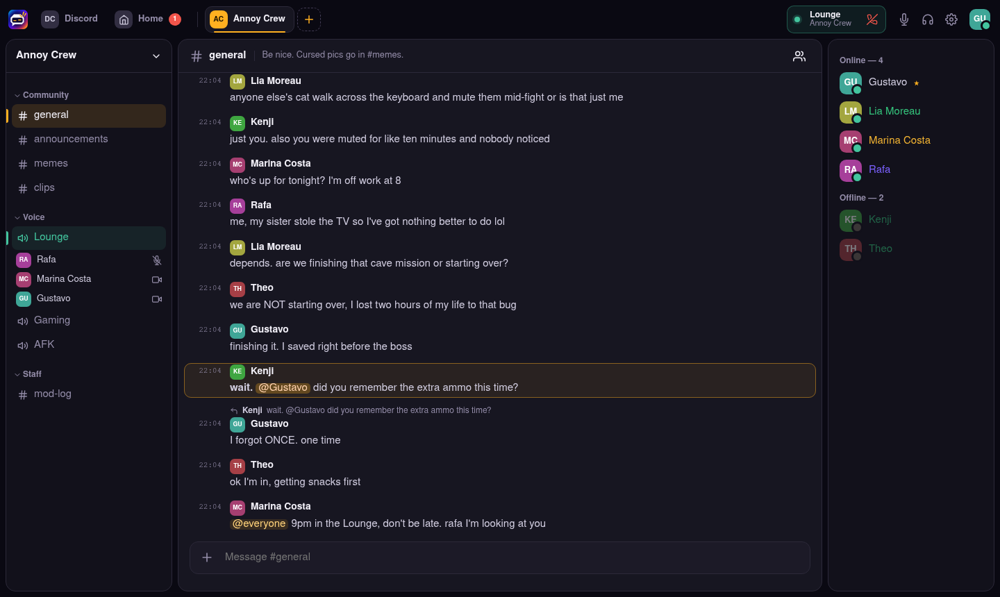
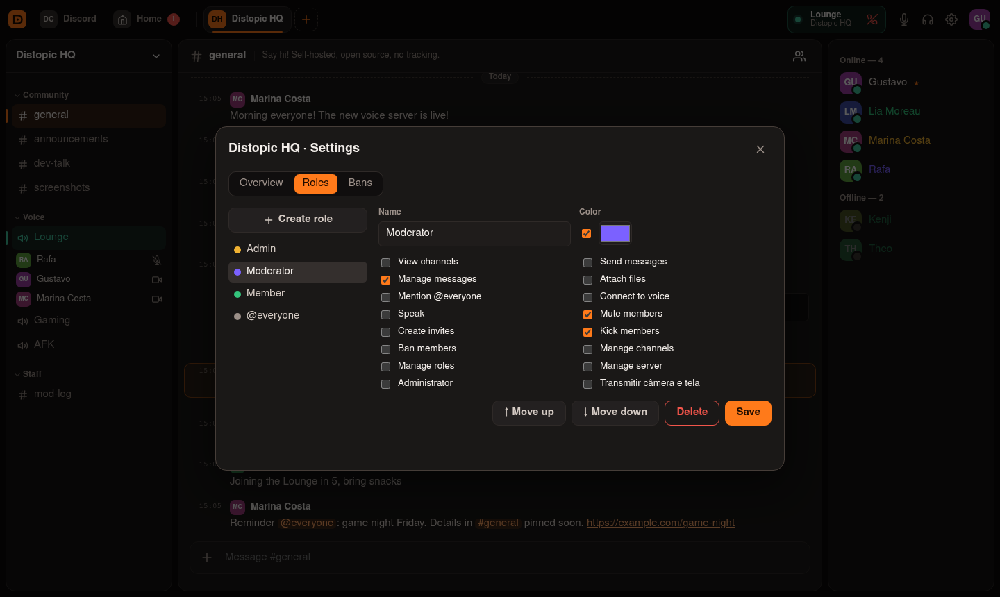
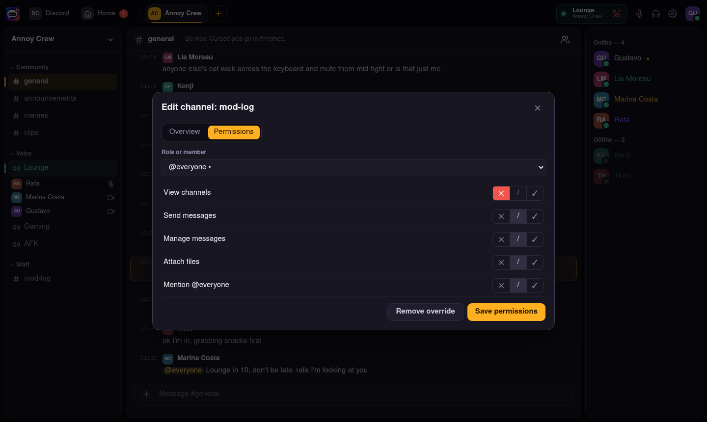
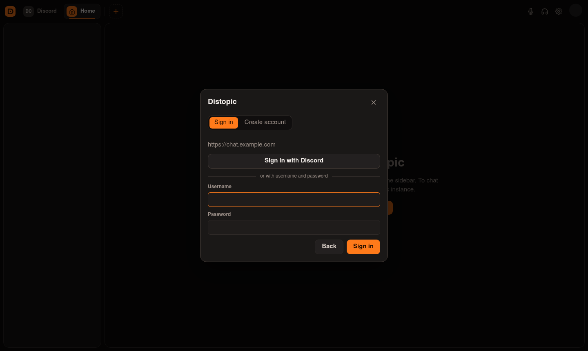

<div align="center">

# Annoy Client

**Um app desktop para os seus servidores Annoy e o Discord oficial.**

[](LICENSE)


[English](README.md) · **Português (Brasil)**



</div>

## Download

- **Windows 10/11:** [Annoy-Setup-x64.exe](https://github.com/GeGLab/annoy-client/releases/latest/download/Annoy-Setup-x64.exe).
  Instala só para o seu usuário, sem pedir administrador. Como o instalador
  ainda não é assinado, o Windows pode mostrar *"O Windows protegeu o
  computador"*: clique em **Mais informações → Executar assim mesmo**.
- **Linux:** [Annoy-x86_64.AppImage](https://github.com/GeGLab/annoy-client/releases/latest/download/Annoy-x86_64.AppImage).
  Rode `chmod +x` e abra.

**Atualizações:** o app avisa quando sai uma versão nova e você decide quando
atualizar. A única exceção é uma correção de segurança crítica, que é
obrigatória. Veja o [SECURITY.md](SECURITY.md).

## Funcionalidades

- **Discord e Annoy lado a lado:** o botão **DC** abre o Discord oficial numa
  visão isolada e persistente. Os servidores Annoy ficam na mesma barra, e a
  troca é com um clique.
- **Várias instâncias ao mesmo tempo:** conecte em quantos
  [servidores Annoy](https://github.com/GeGLab/annoy-server)
  quiser.
- **Texto:** histórico com rolagem infinita, respostas, edição, menções com
  autocompletar, markdown, arrastar e colar arquivos, prévia de imagem e
  "digitando…".
- **Voz:** detecção de voz com medidor ou apertar para falar, mute/deafen,
  escolha de dispositivos, indicador de fala e moderação.
- **Moderação:** editor de cargos, permissões por canal, convites, expulsar e
  banir.
- **Amigos e DMs:** pedidos de amizade, presença e mensagens diretas.
- **Importar do Discord** e **Entrar com Discord**, pela API oficial.
- **Notificações** de menção e DM, e contadores de não lidas (inclusive o do
  Discord).

## Capturas de tela

| | |
| :---: | :---: |
| <br>**Editor de cargos** | <br>**Importar do Discord escolhendo o que vem** |
| <br>**Permissões por canal** | <br>**Entrar com Discord ou conta local** |

Mais capturas no [README em inglês](README.md#screenshots).

> As capturas mostram os rótulos em inglês da futura versão localizada; o build atual tem a interface em português.

## Começando

Precisa do Node.js 22.13 ou mais novo.

```bash
git clone https://github.com/GeGLab/annoy-client.git
cd annoy-client
npm install
npm run dev
```

No app, clique em **Conectar a um servidor Annoy** e digite o endereço (sem
porta, usa a `8787`). Depois, entre com Discord ou crie uma conta.

**Vai entrar na comunidade de alguém?** Basta o client; você não instala
servidor nenhum. Só quem hospeda roda o
[annoy-server](https://github.com/GeGLab/annoy-server), uma vez.

## Sobre a aba do Discord

O client **não** reimplementa o Discord nem usa a API privada de usuário, que
viola os termos e arrisca a sua conta. Ele abre o `discord.com/app` numa visão
separada (`persist:discord`), com o mesmo modelo do
[Vesktop](https://github.com/Vencord/Vesktop). Lá dentro tudo funciona como no
Discord web.

## Licença

[MIT](LICENSE) © GeGLab. O Annoy não é afiliado ao Discord Inc.
