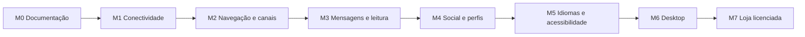

# Annoy — plano de implementação

Atualizado em 30/10/2026. Referências: [especificação](annoy-product-spec.md) e
[progresso](annoy-progress.md). Executar um marco em tarefas pequenas; não tentar
implementar os 20 requisitos em uma única execução.

## 1. Base arquitetural observada

### Repositórios e responsabilidades

- `Annoy.Client`: Electron 45, React 19, TypeScript, electron-vite/Vite, Tailwind
  4, Radix, Lucide e Framer Motion. Distribuição Windows x64/NSIS e Linux/AppImage.
- `../Annoy.Server`: Fastify 5, Zod, SQLite via `node:sqlite`, WAL e índices;
  sessões, autorização, comunidades e persistência são responsabilidade do servidor.
- `packages/protocol`: contrato TypeScript de entidades, permissões e eventos.
  A origem é o servidor; `scripts/sync-protocol.mjs` copia para o cliente. As
  duas cópias são idênticas na análise inicial.
- Backend da Conta Global não foi localizado nos diretórios examinados. M1
  observa chamadas existentes, sem inventar endpoint central ou depender de sua alteração.

### Estado, autenticação e comunicação

- `store.ts` usa Immer e `useSyncExternalStore`; preferências, contas e vista
  persistem em chaves `distopic.*`. Preservar essas chaves e seus dados existentes.
- `client.ts` coordena contas, APIs, navegação e eventos; `gateway.ts` mantém
  um WebSocket por conta com identify, heartbeat, backoff e recuperação.
- `api.ts` autentica requests por Bearer token e resolve uploads. Sessões de
  instância são distintas da Conta Global em `global.ts` e `global-crypto.ts`.
- Cache local guarda servidores e perfil; biblioteca de mídia usa IndexedDB.
  Segredos da Conta Global usam ponte `secrets` e proteção do SO quando disponível.
- Voz usa WebRTC/mediasoup ou backend Cloudflare. Views web de serviços têm
  partições persistentes isoladas; manter a fronteira de main/preload/renderer.

### Interface e reaproveitamento

- Primitivas em `components/ui`, fachada em `components/ui.tsx`, feedback
  assíncrono via `act`/toast, dialogs Radix e `SettingsGuard` para salvar/descartar.
- Tokens em `styles/tokens.css`; identidade registrada em `PRODUCT.md`,
  `DESIGN.md` e `.impeccable`. O pedido atual preserva marca/cores e altera a base
  tipográfica para 16px. Não substituir o sistema visual.
- Há componentes para os seis canais, busca, atividades, perfis, mídia e
  atualizações. Evoluir cada domínio; não trocar o store, reescrever o gateway
  ou adicionar biblioteca de requests sem necessidade demonstrada.
- Alterações locais anteriores estão presentes no cliente. Examinar diffs
  apenas dos arquivos da tarefa antes de editar e preservar esse trabalho.

## 2. Sequência e dependências

Essa é a ordem de entrega. Bases de tradução, acessibilidade e feedback devem
ser respeitadas desde M1; M5 completa migração e validação, sem justificar novos
textos espalhados ou controles inacessíveis nos marcos anteriores.

### M0 — documentos e baseline

1. Criar especificação numerada, plano e progresso.
2. Registrar recursos existentes, contratos, decisões confirmadas e riscos.
3. Registrar baseline já executado, sem confundir análise estática com teste de UI.
4. Verificar cobertura R01–R20, links locais, estados e coerência entre documentos.

Saída: documentação suficiente para retomar M1 sem depender da mensagem original.
Não modificar código funcional neste marco.

### M1 — conectividade e servidores (R01–R04)

1. **M1.1 — estado e isolamento:** extrair tipos/transições testáveis de
   conectividade; adicionar dimensões rede/Global/instâncias ao store. Substituir
   a decisão de bloqueio baseada em qualquer conta desconectada por decisão
   restrita à área afetada. Primeiro teste: A cai, B continua disponível.
2. **M1.2 — requests e ciclo de vida:** timeout, cancelamento, classificação
   de erros e deduplicação de consultas. Proteger respostas contra troca de
   conta/canal; liberar timers, listeners e operações em andamento.
3. **M1.3 — recuperação:** enriquecer eventos do gateway com causa, instante,
   tentativa e próxima tentativa; jitter, pausa offline e retomada. Implementar
   prazo de recuperação em primeiro plano sem desligar tentativas de fundo.
4. **M1.4 — listagem:** adicionar destino de servidores ao `View`, renderer e
   navegação; busca, agrupamento, estados, retry e seleção de conta. Distinguir
   dados conhecidos em cache de disponibilidade confirmada.
5. **M1.5 — preservação e auditoria:** retirar rascunhos/âncoras do ciclo de vida
   de componentes desmontáveis; revisar autenticação, abertura de comunidade/DM,
   configurações e uploads. Registrar operações ainda a revisar em seus marcos.

Saída: R01, R02 e R04 aprovados e auditoria inicial de R03 registrada; sessão
inválida leva a autenticação; queda de uma instância não bloqueia outra, nem
serviços web independentes. Não manter tela presa em reconexão. Atualizar testes
que hoje esperam bloqueio global. R03 só será concluído após revisar também os
fluxos dos marcos seguintes e atender todos os seus critérios.

### M2 — Nova Aba e canais (R05–R06)

1. Reorganizar Nova Aba, separando comunidades e serviços; selecionar conta
   de destino em criação/convite quando houver mais de uma.
2. Consolidar apresentação de loading, erro, vazio, acesso negado e recuperação
   usando primitivas existentes e rótulos acessíveis.
3. Revisar Texto/Voz, depois Arquivo, Código e salas Filme/Música, uma tarefa
   por modalidade. Manter ações, conflitos, permissões e limpeza de recursos.
4. Remover o carregamento antecipado de detalhes de todas as comunidades;
   adicionar resumos/consultas incrementais para comunidades e membros.
5. Migrar busca/ordenação da biblioteca de arquivos para consulta no servidor
   quando precisar cobrir o acervo inteiro, sem filtrar apenas páginas locais
   como se representassem o resultado completo.

Saída: layouts próprios e estados completos nas seis modalidades; coleções
grandes não exigem carregar todos os membros, comunidades ou arquivos.

### M3 — histórico, leitura e fixações (R08, R09, R19)

1. Criar contrato adicional de histórico bidirecional e testes de consultas
   indexadas; conservar a rota legada que retorna `Message[]`.
2. Implementar janela de páginas, deduplicação, descarte e virtualização;
   preservar contexto da busca, âncora, anexos e mensagens de altura variável.
3. Persistir leitura por usuário/canal e sincronizar sessões desse usuário;
   reconstruir contadores/menções com dados persistidos e acesso atual.
4. Implementar posicionamento nas não lidas, divisor estável e salto às recentes.
5. Acrescentar fixações persistidas, permissões, eventos e painel com contexto.

Saída: validação contra um milhão de mensagens em banco temporário e dois
clientes; nenhuma lista de mensagens cresce indefinidamente no store/DOM.

### M4 — amigos, perfil e privacidade (R10–R13)

1. Ampliar categorias de atividade e resumo compacto com negociação de
   capacidade; reutilizar presença, ícones e detectores reais.
2. Implementar detalhes de perfil e autorização por audiência antes de
   apresentar redes/contatos na interface.
3. Ampliar editor com validação, prévia e save/discard; implementar modal de
   perfil completo e invalidar detalhes após atualização/revogação de acesso.
4. Acrescentar consentimento e armazenamento limitado do histórico; expiração,
   exclusão, concorrência entre dispositivos e informação de duração incompleta.

Saída: contatos privados por padrão; histórico desligado por padrão; nenhum
campo sensível sai em resposta/evento genérico para visitante sem autorização.

### M5 — localização e acessibilidade (R14–R16)

1. Centralizar catálogos tipados por domínio e formatadores `Intl`, incluindo
   pluralização, calendário, acessibilidade e textos próprios do main.
2. Migrar cada domínio e adicionar catálogos pt-BR/en/es/fr/it/ja/zh-Hans com
   paridade de chaves; fallback pt-BR e tratamento de mensagens remotas desconhecidas.
3. Implementar idioma/região/hora independentes, sugestão regional, aviso
   não impeditivo e restauração do idioma anterior.
4. Aplicar base 16px e escala 16–24px, unidades relativas e links sublinhados;
   incluir prévia sem salvar e integração com SettingsGuard.
5. Validar texto expandido, teclado, leitor de tela, zoom, foco e movimento reduzido.

Saída: sete línguas cobertas, sem alteração automática do idioma salvo;
controles utilizáveis na fonte máxima e zoom de 200%.

### M6 — preferências desktop e atualizador (R17, R18, R20)

1. Criar preferências versionadas no main e ponte tipada restrita ao frame
   local, retornando suporte, valores salvos, aplicados e reinício necessário.
2. Ler aceleração antes de ready; salvar mudança e oferecer reinício explícito.
3. Implementar autostart Windows/XDG Linux, início minimizado e bandeja
   configurável; manter saída/restauração e segunda instância.
4. Evoluir atualizador existente com exclusão de checagens simultâneas,
   notificação por versão e recuperação; testar em feed local, sem publicar.

Saída: testes de pacotes Windows/Linux; opções não suportadas explicadas;
nenhuma janela fica oculta sem mecanismo funcional de restauração.

### M7 — catálogo licenciado (R07)

1. Preparar manifestos versionados e divididos em páginas, com licença,
   autoria, origem e créditos; começar com catálogo próprio/OpenMoji.
2. Migrar IndexedDB de forma aditiva para separar metadados e blobs e permitir
   índices/cursores. Não usar `getAll()` de blobs para a listagem.
3. Criar pesquisa/categorias/packs, carregamento incremental, cache e instalação
   atômica; imagens sob demanda e descarte de object URLs.
4. Preservar importação/exportação, limites atuais e fluxo explícito de envio;
   testar packs legados, quota, offline e downloads interrompidos.

Saída: catálogo real navegável sem baixar todos os itens; cada ativo distribuído
tem licença verificada. Integração emoji.gg não é dependência.

## 3. Contratos e políticas de implementação

### Conectividade e requests

- Manter estados de transporte `connecting/ready/offline/invalid` compatíveis
  e acrescentar diagnóstico separado. Estado global não é um booleano agregado.
- Registrar rede como desconhecida/disponível/offline informado; serviço
  Global e instâncias têm resultado observado, causa, horário e próxima tentativa.
  Falha em todos os hosts não demonstra sozinha ausência de internet.
- Observar requests normais do Global e consultas autenticadas seguras já
  existentes. Sem sessão/consulta válida, conservar estado desconhecido, sem
  fabricar endpoint `/health` ou enviar credenciais em probes de fundo.
- Timeout padrão: consultas 15s, operações comuns 20s; uploads/tarefas longas
  têm política própria, progresso e cancelamento. Leitura repetível pode ser
  retomada; não repetir mensagens ou mutações automaticamente sem idempotência.
- Backoff 1/2/4/8/16/30s com jitter, pausado quando o sistema informa offline.
  Retorno online/retry manual antecipa a tentativa sem criar outro socket vivo.
- Prazo de recuperação visível: 60s desde a queda; reinício anunciado mantém
  até 180s. Redirecionar apenas se a vista ainda pertence à instância afetada.
  Recomeçar automaticamente só após nova ação/recuperação, sem alternar telas em loop.
- Reutilizar cache por conta e chave completa de requisição. Incluir conta,
  comunidade/canal e parâmetros nas chaves; checar geração antes de aplicar resposta.
- Rascunhos por conta/canal: texto e reply em armazenamento local versionado;
  arquivos apenas em memória durante a sessão. Limpar ao enviar/descartar e ao
  remover conta. Não registrar conteúdo em logs; validar a referência reply ao voltar.

### Histórico e leitura

- Adicionar `GET /channels/:id/history` com `limit` (padrão 50, máximo 100)
  e um seletor exclusivo `before`, `after` ou `around`. Retornar `items`,
  `beforeCursor`, `afterCursor`, `hasOlder` e `hasNewer`; cursores delimitam
  os itens retornados. Conservar `GET .../messages` para consumidores antigos.
- Usar ordenação lexical por ID já adotada no backend e índice `(channel_id,id)`.
  Validar canal/acesso em toda consulta; alvos ausentes/de outro canal não expõem dados.
- Cache máximo: 500 mensagens/canal e 5.000 globais; descartar páginas mais
  distantes da âncora e canais menos recentes, sem descartar rascunhos.
- Justificar a única dependência nova inicialmente prevista,
  `@tanstack/react-virtual`, por medição/virtualização de itens de altura variável.
  Selecionar versão compatível e registrar no lockfile durante M3; não instalar em M0.
- Âncora usa ID + deslocamento em pixels; eventos fora da janela alimentam
  indicador de novidades, sem anexar registros separados por intervalo não carregado.
- Adicionar tabela `channel_read_states` com chave `(user_id,channel_id)`,
  cursor monotônico e instante de atualização. Expor consulta/gravação do
  próprio usuário, de forma idempotente, e evento `READ_STATE_UPDATE` só às suas sessões.
- Validar cursor pertencente ao canal; comparar avanço no servidor. Exclusão
  do alvo não apaga a fronteira ordenável; buscar próxima mensagem acessível.
- Consultar contadores/menções no servidor com índice e limites apropriados;
  não reconstruir não lidas carregando todo o histórico no cliente.
- Navegar não marca como lido. Janela focada e mensagem visível habilitam
  confirmação agrupada; leitura remota não move o scroll atual. “Marcar servidor
  como lido” continua ação explícita e atualiza seus canais autorizados.
- Primeira adoção sem marcador: posicionar recentes e estabelecer fronteira
  após visibilidade, sem transformar todo o histórico antigo em pendência.

### Fixações e perfis

- Tabela `message_pins`, com unicidade por canal/mensagem, autor e data;
  operações idempotentes de PUT/DELETE em `/channels/:id/pins/:messageId`,
  consulta paginada de fixações e evento `PIN_UPDATE` para assinantes autorizados.
  Exclusão de mensagem remove pin por FK/transação. Em DM permitir participantes;
  em comunidade exigir leitura e `MANAGE_MESSAGES`.
- Manter identidade básica de `User`; criar tipos `ProfileDetails`,
  `ProfilePrivacy` e `ActivityHistoryEntry` para dados sob demanda.
- Detalhes em `GET /users/:id/profile`; edição própria em
  `PATCH /users/@me/profile`; consentimento de histórico em preferências do
  próprio perfil; `DELETE /users/@me/activity-history` apaga todas as entradas.
- Guardar contatos/redes e audiência por campo. Valores de audiência:
  `self`, `friends`, `community`; `community` inclui amigos e membros de servidor
  em comum. Contatos/redes novos começam em `self`.
- E-mail: sintaxe validada com Zod no backend, sem indicar verificação.
  Telefone: E.164; redes: HTTPS, host de plataforma permitido, sem credenciais.
  Site pessoal aceita HTTPS; normalizar host e eliminar protocolos executáveis.
- Filtrar valores privados em todas as respostas e invalidar caches por evento
  sem transportar o valor sensível. Revalidar audiência após amizade/membership mudar.
- Histórico por instância/usuário, com consentimento salvo separadamente:
  guardar até três sessões encerradas e não expiradas (30 dias), sem reconstruir
  passado anterior ao consentimento. Desativar também exclui entradas existentes.
- Usar identidade de sessão/dispositivo para deduplicação. Encerramento
  confirmado pode ter duração; TTL/desconexão abrupta registra informação
  incompleta, sem duração exata. Não persistir arquivo/projeto, caminhos ou conteúdo.
- Categorias extras de atividade devem ser negociadas em capability; manter
  payload antigo de até três categorias conhecidas para clientes legados.

### Localização e preferências desktop

- Catálogos tipados por domínio, interpolação/plural via `Intl`, fallback pt-BR;
  validar paridade em teste. Não introduzir biblioteca de i18n sem necessidade
  adicional demonstrada. Traduzir erros conhecidos por código e manter fallback remoto.
- Instalações existentes mantêm pt-BR; região e ciclo de hora usam sugestão do
  sistema na primeira configuração. Salvar escolha explícita e idioma anterior.
- Preferências main: arquivo JSON versionado no `userData`, gravação atômica,
  valores validados e IPC com operações conhecidas. Renderer não recebe acesso ao FS.
- `hardwareAcceleration=true`, `startAtLogin=false`, `startMinimized=false`;
  bandeja conserva padrão Windows atual e fica condicionada ao ambiente no Linux.
- Ler aceleração antes de `app.whenReady()`. Não usar `openAsHidden`, removido
  do Electron 45; gerenciar a janela e argumentos de inicialização explicitamente.
- Autostart Windows usa Electron; Linux usa entrada XDG do usuário com caminho
  estável da AppImage. Desativar registro em desenvolvimento e explicar caminho móvel.
- Preservar verificações de atualização em 5s após primeira carga e a cada
  seis horas, política de aviso crítico, download opcional comum e instalação
  no próximo encerramento após download. Não trocar feed/instalar release em M0.
- Usar integridade e transporte do atualizador; testar checksum inválido.
  Assinatura de código do instalador atual está desabilitada: não apresentar
  atualização como assinatura de editor verificada sem implantação dessa infraestrutura.

### Loja e compatibilidade de protocolo

- Manifestos próprios por página/categoria; busca usa índice de metadados,
  nunca leitura integral de blobs. Cache mantém versão/origem, status de instalação
  e invalidação; persistir pack completo só após download/validação integral.
- Migrar packs legados em transação IndexedDB, preservando importação/exportação
  e atribuição. Liberação de URLs e limite de concorrência fazem parte da tarefa.
- Adicionar capacidades opcionais em READY para histórico bidirecional, leitura,
  pins, perfis detalhados, histórico consentido e atividades ampliadas. Ausência
  mantém caminhos legados e informa limites, sem fingir persistência compartilhada.
- Fontes e direitos: ver referências da especificação. Não raspar emoji.gg;
  licença declarada em JSON importado não é prova de direitos para distribuí-lo
  como catálogo oficial. GIPHY continua integração própria, com sua atribuição.

## 4. Mapa dos módulos afetados

Os caminhos abaixo são pontos de partida, não autorização para refatorá-los por
inteiro. Ler apenas a tarefa atual e suas dependências; conferir o diff local.

| Domínio | Cliente | Annoy.Server |
| --- | --- | --- |
| Conectividade | `api.ts`, `gateway.ts`, `client.ts`, `global.ts`, `store.ts`, `App.tsx`, `components/ConnectionOverlay.tsx`, `ServerView.tsx`, `TopBar.tsx`, `AccountModals.tsx` e nova listagem. | Rotas de resumo/consulta apenas quando necessárias; não alterar Global sem código/contrato disponível. |
| Navegação/canais | `components/Services.tsx`, `Home.tsx`, `ServerView.tsx`, `VoiceStage.tsx`, `Chat.tsx`, `features/channels/*` e estilos de canais. | `routes/servers.ts`, `routes/channels.ts`, `repo.ts`, `code.ts`, `playback.ts` e autorização. |
| Histórico/leitura/pins | `client.ts`, `store.ts`, `components/Chat.tsx`, busca e biblioteca de arquivos. | `db.ts`, `repo.ts`, `routes/channels.ts`, `gateway.ts`, `events.ts`, permissões e protocolo. |
| Perfil/atividade | `components/Home.tsx`, `UserProfile.tsx`, `settings/ProfileEditor.tsx`, `UserSettingsModal.tsx`, `features/activity/*`, `shared/activity.ts`, `main/activity/*`. | `routes/auth.ts`, `routes/social.ts`, novo domínio de perfil/histórico, `activity.ts`, `presence.ts`, `db.ts`, `repo.ts` e eventos. |
| Idioma/acessibilidade | `format.tsx`, `lib`, catálogos, settings, componentes, estilos/tokens, textos do main. | Códigos de erro estáveis e validação; não traduzir conteúdo dos usuários. |
| Desktop/updates | `main/index.ts`, `main/updater.ts`, preload, `env.d.ts`, shared, `components/Updates.tsx` e settings. | Sem dependência de migração de banco para preferências locais. |
| Loja | `features/expression/library.ts`, `MediaLibrarySettings.tsx`, `MediaPicker.tsx`, `navigation.ts`, ativos/atribuições e estilos. | Sem backend novo obrigatório para catálogo local licenciado. |
| Validação | `tests/workspace.spec.ts`, `experience.spec.ts`, `desktop.spec.ts`, `scripts/tests` e novos testes de domínio. | `tests` de integração com SQLite/diretórios temporários e sessões autorizadas. |

## 5. Migração, entrega e reversão

- SQLite: migrações aditivas/idempotentes no padrão do projeto, transações,
  índices e chaves estrangeiras; testar banco novo e existente. Não migrar
  instância publicada nesta execução nem remover colunas/tabelas antigas.
- Dados locais: defaults compatíveis, schema versionado, recuperação de JSON
  inválido e migração de IndexedDB. Preservar contas/sessões/chaves `distopic.*`.
- Ordem de compatibilidade: implementar/validar servidor e protocolo, sincronizar
  contrato no cliente, então ativar UI por capabilities. Testar servidor antigo
  e cliente antigo com payload negociado. Versões publicadas não são pressupostas.
- Documentar suporte por capacidade, sem usar apenas versão como prova de que
  recurso está disponível. Não marcar tarefa concluída por mock de UI.
- Entregar uma tarefa revisável por vez, corrigir regressões antes de seguir,
  atualizar progresso após cada marco. Não criar commits automaticamente.
- Rollback de aplicação conserva tabelas/dados aditivos; catálogo e preferências
  exigem leitura tolerante a campos desconhecidos. Não fazer downgrade destrutivo
  de banco/IndexedDB para acompanhar rollback de código.

## 6. Plano de testes

### Por tarefa e marco

- Executar typecheck dos repositórios alterados. O cliente não possui script
  de lint configurado; não relatar lint inexistente como aprovado. Introdução
  de ferramenta de lint exige justificativa separada, não é dependência de M0.
- Testar transições de conectividade com relógio/socket/fetch controlados:
  uma instância falha e outra responde, Global falha, offline/online, 401/403,
  handshake sem READY, retry manual, prazo expirado e reinício anunciado.
- Playwright: navegação, estados, preservação de rascunho, foco, teclado,
  troca rápida de canal/conta, suspensão/retorno e ausência de bloqueio global.
- Servidor: autorização e persistência reais em banco/diretório temporários;
  índices, limites, cursores inválidos, concorrência e reconexão de dois clientes.
- R08/R09: seed de um milhão de mensagens apenas em banco temporário; verificar
  plano de consulta indexado, páginas limitadas, cache/DOM limitados e âncora após
  prepend, mídia tardia, exclusões, redimensionamento e mudança de fonte.
- R19: pin idempotente, participantes da DM, moderador/membro comum,
  deleção da mensagem, revogação de acesso e evento para audiência correta.
- R10–R13: matriz dono/amigo/membro/sem vínculo; consentimento desligado,
  expiração/exclusão, interrupção sem duração confirmada e perda do último vínculo.
- R14–R16: paridade de chaves, pluralização, sete línguas, região/hora,
  restauração, fonte máxima, zoom 200%, leitor de tela, temas e movimento reduzido.
- R17/R18: pacotes Windows/Linux, GPU ligada/desligada, autostart,
  minimização, bandeja ausente, segunda instância, saída e reinício.
- R20: feed de teste, versão ausente/disponível/crítica, checks concorrentes,
  download interrompido, checksum incorreto, retry e build não atualizável.
- R07: catálogo grande, instalação atômica, cache vencido, offline, quota,
  importação inválida/legada, metadados de licença e object URLs liberadas.

### Verificação visual

Usar a identidade/tokens atuais e a superfície real antes de editar UI. Validar
em lotes nos temas claro/escuro e tamanhos desktop suportados; corrigir os
defeitos observados em conjunto e confirmar. Fixtures/mocks de teste não são
evidência de implantação nem substituem integração com instância real de teste.

## 7. Riscos e dependências operacionais

| Risco/dependência | Tratamento |
| --- | --- |
| Store/client concentram coordenação e carregam detalhes de todas as comunidades. | Extrair apenas tipos/transições e caches necessários; consultas incrementais, concorrência limitada e testes de isolamento. |
| Scroll com anexos e virtualização pode deslocar leitura. | Âncora por ID/offset, medição dinâmica, teste com mídia tardia e páginas descartadas. |
| Serviços antigos não persistem leitura/pins/perfis novos. | Capability negociada e mensagem de limitação; não simular sincronização no cliente. |
| Histórico transforma dado efêmero em persistente. | Consentimento separado, limite de três/30 dias, audiência no backend, exclusão e invalidação imediata. |
| Diagnóstico de internet não é conclusivo pelo navegador. | Estado desconhecido e evidências por destino; não culpar rede global por falha de uma instância. |
| Conta Global tem backend não disponível nesta árvore. | Observar contratos existentes em M1; registrar bloqueio pontual se futura tarefa realmente exigir mudança central. |
| Linux varia em tray, autostart, captura e detecção. | Matriz de capacidades e teste em ambiente Linux; não declarar suporte com base em execução Windows. |
| Instaladores atuais não têm assinatura de editor. | Preservar verificação de integridade; não prometer autenticidade de editor. Configuração de assinatura/publicação depende de infraestrutura e credenciais do mantenedor. |
| Ativos de terceiros podem restringir redistribuição. | Catálogo próprio/OpenMoji com evidência por ativo; emoji.gg sem importação automática. |
| Há trabalho local anterior no cliente. | Preservar diffs; revisão direcionada antes de editar; nenhuma limpeza/reset automático. |

Não há decisão de produto pendente para M0/M1. Credenciais de assinatura,
publicação e ambientes empacotados de teste são dependências operacionais de
marcos futuros; não impedem implementação local/documentação.

## 8. Próxima tarefa executável

**M1.1 — isolar falhas por instância.** Ler `store.ts`, `client.ts`, `gateway.ts`,
`App.tsx`, `ConnectionOverlay.tsx` e testes de reconexão existentes, incluindo
seus diffs locais. Criar estado/transições de conectividade com teste em que
conta A fica offline e conta B continua utilizável. Adaptar o bloqueio à área
afetada, preservar autenticação de recuperação e manter serviços independentes.
Executar typecheck e testes direcionados; registrar resultados no progresso
antes de iniciar timeouts e a nova listagem.
